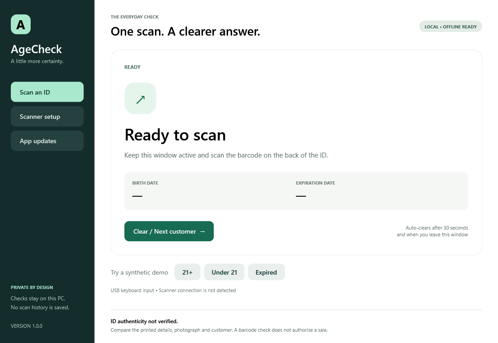

# AgeCheck

**A focused, private age-checking app for the Windows counter.**

Scan an ID barcode, see whether its birth date indicates an age of at least 21, and check its expiration date. Built with C# / .NET 10 LTS and native WPF, with a calm interface, large text and brief transitions.

[Download the latest release](https://github.com/PrithviGhale/ID-Reader/releases/latest) · [Scanner setup](docs/SCANNER_SETUP.md) · [Build and publish](docs/RELEASING.md)



## Install

1. Open **Releases** and download `PrithviGhale.AgeCheck-win-Setup.exe`.
2. Run the installer on Windows x64. The .NET runtime is included; no developer tools are needed.
3. Configure your Honeywell Xenon XP 1950g as described in the [setup guide](docs/SCANNER_SETUP.md).
4. Open **Scan an ID**, keep AgeCheck focused, and scan the PDF417 barcode on the back of the card.

The first release is **unsigned**. Windows may warn about an unknown publisher. This is a working packaged build, not a code-signed release. Verify the download source and follow your organization's software policy.

## What you see

| Result | Meaning |
| --- | --- |
| **21 or older — barcode age check passed** | The encoded birth date meets the age threshold and the encoded expiration date has not passed. |
| **Under 21** | The encoded birth date is below the threshold. |
| **Expired** | The encoded expiration date is before today, regardless of age. |
| **Unable to check — manual review required** | Data is incomplete, unsupported, malformed, ambiguous or inconsistent. |

**ID authenticity not verified.** A counterfeit can contain a correctly formatted barcode. Always compare the printed details, photograph and customer. AgeCheck does not inspect holograms or ultraviolet features, query government records, check revocations, or authorize a sale.

Use **Clear / Next customer** or Escape between customers. Synthetic examples are available inside the app and every demo result displays **DEMO**.

## Privacy and performance

- ID processing is local and works offline. No scan history, raw barcode files, names, addresses, license numbers or images are saved by the app.
- Results and input clear after 30 seconds, on the next scan, and when the window loses focus. Changing pages also clears them.
- Only the startup-update preference is stored in `%LOCALAPPDATA%\AgeCheck\settings.json`.
- No analytics or application crash reporting. Update requests contain no scanned ID data. GitHub receives ordinary network metadata when checking/downloading updates.
- No browser engine, global keyboard hook, background service or continuous animation. Input and one-shot timers drive the interface; all scan timers stop when idle.
- Transitions last 180 ms and respect Windows animation preferences; software-rendered sessions skip them.

Clearing removes application references and visible data; .NET garbage collection and Windows memory management do not provide a guarantee of immediate secure memory erasure. Avoid collecting process dumps while real IDs are in use.

## Supported barcode subset

AgeCheck validates AAMVA `ANSI ` headers, version **08, 09 or 10**, subfile offsets/lengths and exactly one `DL` or `ID` subfile. `DCG`, `DBB`, `DBA` and `DBD` are required for country, birth, expiration and issue dates. Duplicate fields, overlapping subfiles, missing data, invalid dates and unexpected trailing content require review. It is an age/date checker, not a validator of every mandatory AAMVA identity field.

Dates are explicitly `MMddyyyy` for `USA` and `yyyyMMdd` for `CAN`; the app never guesses a country. Dates use the PC's local calendar date, so keep the system clock correct. The expiration date is treated as valid through that day. A February 29 birthday reaches 21 on March 1 in a non-leap year; February 28 in that boundary year always requires manual review because jurisdiction-specific policy can differ. Expiration takes priority in the displayed outcome.

The capture limit is 16,384 characters and 20 seconds. After 700 ms without input, the app validates the **whole frame**; an embedded newline does not submit a scan. A scan beep is not proof that every character arrived. Unsupported versions (including newer formats), modified scanner output and non-AAMVA documents require manual review.

## Updates

Open **App updates** to check for stable releases, read release notes, download an update, then choose **Update and restart**. You can return to scanning and postpone restart. Startup checks can be disabled. Failed checks/downloads leave offline checking available.

Updates use Velopack's `GithubSource` and package verification, over HTTPS, from this public repository. No tokens are embedded. Development and portable copies explain that the Setup installer is required for in-app updates.

**Pushing ordinary code does not update installed apps. Publishing a new versioned GitHub release does.** See the [release guide](docs/RELEASING.md). The repository URL and package identity live in one place: [`release-config.json`](release-config.json).

## Build and test

On Windows with the .NET 10 SDK:

```powershell
dotnet restore
dotnet test -c Release
dotnet run --project src/AgeCheck
./scripts/package.ps1 -Version 1.0.0
```

The packaging script produces the self-contained application, installer and update assets under `artifacts/`. It uses the pinned Velopack CLI version in `dotnet-tools.json`.

For synthetic UI checks after a Release build:

```powershell
Start-Process ./src/AgeCheck/bin/Release/net10.0-windows/AgeCheck.exe -ArgumentList '--self-test' -Wait
Get-Content artifacts/ui-test-results.txt
```

`--screenshot` renders synthetic screen previews to `artifacts/screenshots/`. These explicit developer modes are never run during ordinary scanning.

## Verification and limits

Automated tests cover exact age boundaries, leap days, expiration day, both supported date conventions, invalid/conflicting/missing/duplicate fields, every truncated prefix of a sample, framing, multiline input, suffixes, control substitutions and buffer limits. The UI self-test exercises scan states, next-scan clearing, the real privacy timer, deactivation handling and the uninstalled-update path.

Physical testing with a Honeywell **1950GHD-2-INT-N**, varied jurisdiction barcodes, and an installed-version-to-newer-version update remain unverified. The test inputs are synthetic. Check [validation notes](docs/VALIDATION.md) before deploying at a counter.

## References and license

- [Honeywell Xenon XP 1950g documentation](https://automation.honeywell.com/us/en/products/productivity-solutions/barcode-scanners/general-purpose-handheld/xenon-xp-1950g-general-duty-scanner)
- [AAMVA 2020 card design standard, Annex D](https://www.aamva.org/getmedia/99ac7057-0f4d-4461-b0a2-3a5532e1b35c/AAMVA-2020-DLID-Card-Design-Standard.pdf)
- [Current AAMVA standards](https://www.aamva.org/topics/driver-license-and-identification-standards)
- [Velopack integration](https://docs.velopack.io/getting-started/csharp), [GitHub sources](https://docs.velopack.io/integrating/update-sources), [release workflow](https://docs.velopack.io/distributing/github-actions), [code signing](https://docs.velopack.io/packaging/signing)

MIT licensed. See [LICENSE](LICENSE).
