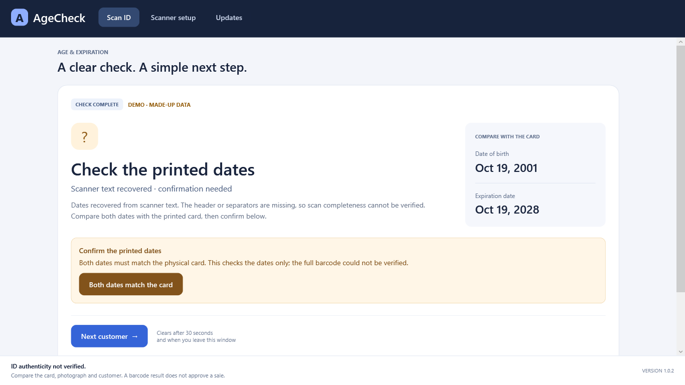
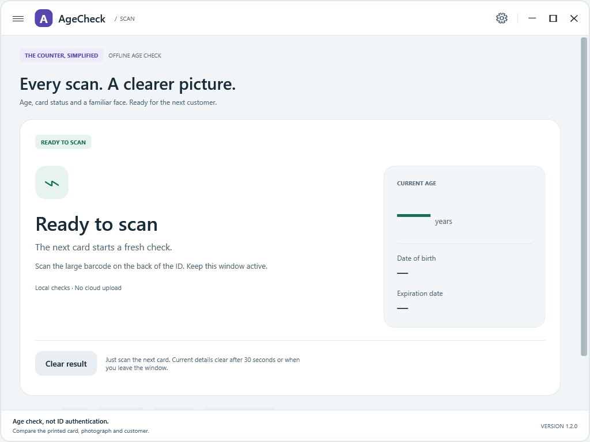
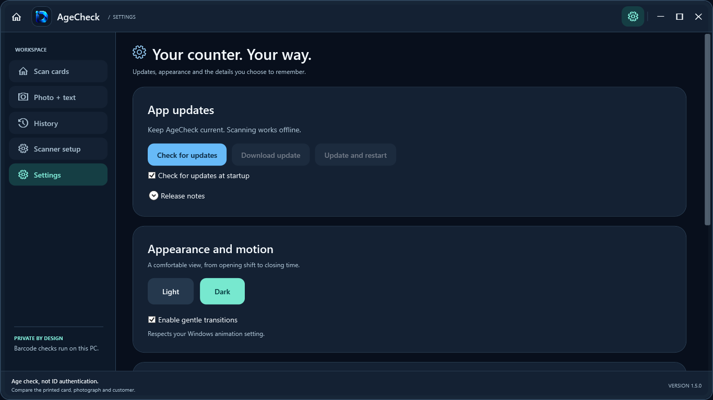
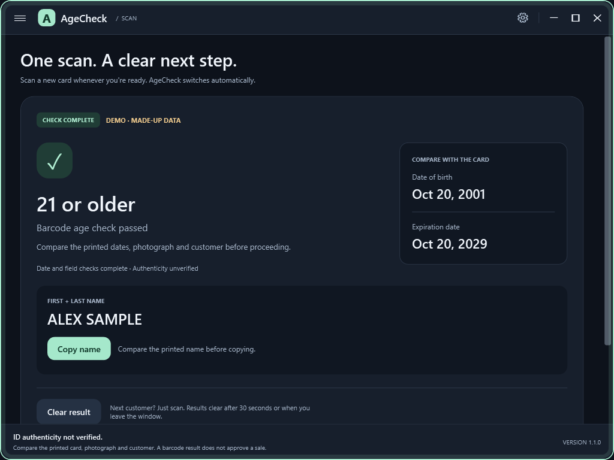
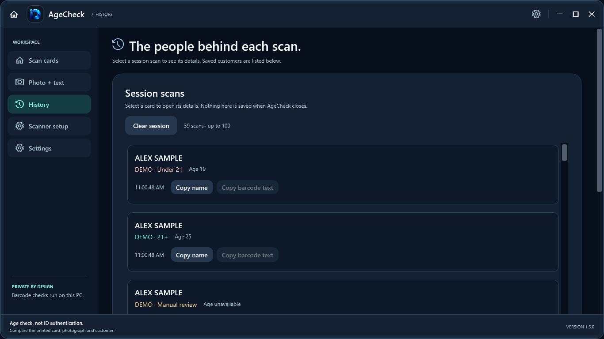
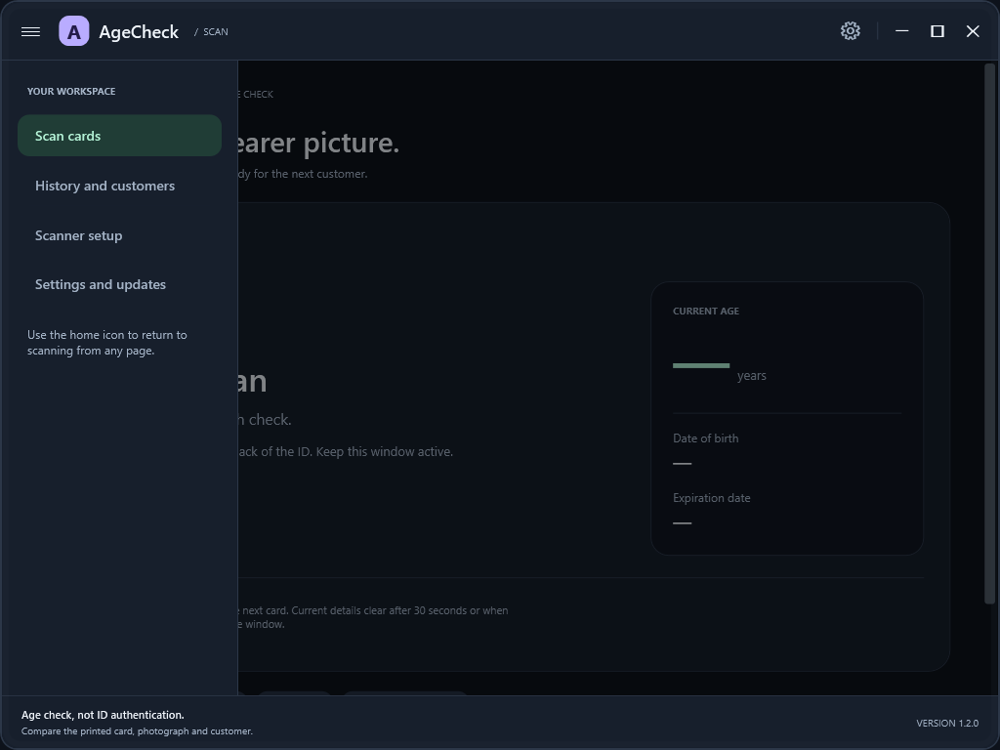

<div align="center">

# AgeCheck

### Scan an ID. Check the age. Keep it private.

A simple Windows app for checking the birth date and expiration date in an ID barcode.


**[Download AgeCheck](https://github.com/PrithviGhale/ID-Reader/releases/latest)** · **[Scanner setup](docs/SCANNER_SETUP.md)** · **[What's new](https://github.com/PrithviGhale/ID-Reader/releases)**

</div>


## What it does

| Feature | How it helps |
| --- | --- |
| **21+ age check** | Checks whether the barcode birth date says the person is at least 21. |
| **Expiration check** | Shows when the ID's barcode expiration date has passed. |
| **Clear results** | Large text shows 21+, Under 21, Expired, or Manual review. |
| **Date comparison** | Shows the birth date and expiration date so you can compare them with the card. |
| **Scanner text recovery** | Can recover dates from supported scans with missing headers or line breaks, then asks you to confirm the printed dates. |
| **Uppercase names** | Shows a readable first and last name in ALL CAPS, with a copy button for your rewards form. |
| **Session history** | Keeps up to 100 names, times and results in memory until you close the app. Clear it anytime or turn it off. |
| **Local processing** | Does not write scan history, raw barcodes or ID details to disk. Copying a name puts it on your Windows clipboard. |
| **Automatic clearing** | Clears results after 30 seconds, on the next scan, or when you leave the window. |
| **Works offline** | No internet is needed to check a scan. |
| **Built-in updates** | Check for updates, read what's new, download, and restart when you choose. |
| **Simple, smooth design** | A clean Windows interface with short animations and no constantly running effects. |
| **Light and dark modes** | Choose your preferred look in Settings. Your choice stays on this PC. |
| **Opening and page animations** | A short opening reveal and smooth page changes, with a setting to turn them off. |
| **Flexible layout** | Adjusts to small windows, laptops, large monitors, and Windows display scaling. Scroll to reach extra content on small screens. |
| **Color-changing edges** | Green for 21+, red for under 21 or expired, and orange for manual review. Text explains each result too. |
| **Collapsible menu** | Open the left menu with ☰. Settings are behind the gear at the top right. |
| **Demo mode** | Try made-up examples without scanning an ID. Each demo is clearly marked. |

## Get started

1. **[Open the latest release](https://github.com/PrithviGhale/ID-Reader/releases/latest)** and download **`AgeCheck-win-x64-Setup.exe`**.
2. Run the installer. Everything the app needs is included.
3. Follow the **[scanner setup guide](docs/SCANNER_SETUP.md)**.
4. Open **☰ → Scan cards**, keep the window active, and scan the barcode on the back of the card.
5. Compare the result with the printed card and the customer. **Just scan the next card** for the next customer; no Next button is needed. Clear result is optional.

**Already using version 1.0.0?** Close and uninstall that version, then install the latest AgeCheck Setup. This one-time reinstall removes the old publisher and installation name. Versions 1.0.1 and newer can update inside the app. Session history is never migrated or saved across restarts.

## What you need

- A Windows x64 PC.
- A scanner that can read PDF417 barcodes and type them into Windows.
- The setup guide is written for the **Honeywell Xenon XP 1950g**. Physical testing with that scanner is still needed.

AgeCheck supports selected US and Canadian AAMVA barcode formats, versions 08–10. Unsupported, incomplete, or conflicting data asks for manual review. It does not support every ID format.

### If your scanner sends one long line

Version **1.1.1** also handles supported headers where the scanner preserves only some line breaks, tabs or record separators, including accented header tokens after line breaks. Recovered names include a reminder to compare with the printed card. Open **App updates** to install the new release; Setup installations on the current package identity can update in place.

Version **1.0.3** recovers unique date and country fields from supported flattened scanner output, including the specific `@ÂNSI` header variation, missing separators, or a missing header/first field character. Instead of stopping at that header error, it shows **Check the printed dates**. Compare both dates with the physical ID, then choose **Both dates match the card**. The app calculates the age and expiration result from those confirmed dates.

This is a **date-only check**. Missing separators mean the app cannot prove the whole barcode arrived. It never gives an automatic pass from recovered text. Missing, invalid, or conflicting dates still need manual review. For full barcode validation, use the recommended [scanner settings](docs/SCANNER_SETUP.md).

<details>
<summary>See the new scanner recovery screen</summary>



</details>

## Light or dark. Your choice.

Open the **gear at the top right** and choose **Light** or **Dark**. You can also turn animations or session history off. Preferences save automatically. Opening and page changes use brief zoom-and-slide animations and respect the Windows animation setting.



<details>
<summary>See appearance and animation settings</summary>



</details>

## Know what the result means

**ID authenticity not verified.** The app checks dates in the barcode. It cannot prove the card is real or approve a sale. Always compare the printed details, photograph, and customer.

Extra barcode checks flag conflicting revision/issue dates, unknown field codes and invalid name flags. An orange edge means **manual review**, not proof of a fake. A non-REAL-ID compliance flag is not treated as a fake-ID indicator.

## Names and history

Names come from supported first/last-name fields; middle names are excluded. Shortened, missing or ambiguous names are shown as unavailable rather than guessed. Compare the printed name before copying it.

Open **☰ → History** to see names, scan times and results from this app session. Recovered-date confirmation updates the same entry. Demo entries are marked DEMO. History is capped at 100 entries, has a Clear history button, and can be switched off in Settings; switching it off also clears it.

Current scan results still clear after 30 seconds, on the next scan and when the app loses focus. History names remain in memory until cleared or the app closes. No history files are created. A copied name can remain on the Windows clipboard after the app closes and follows your Windows clipboard settings.

<details>
<summary>See the new scan result, history and menu</summary>







</details>

The current installer is **unsigned**, so Windows may show an unknown-publisher warning. Physical scanner testing and a full installed-app update test are still outstanding. See the **[test results and limits](docs/VALIDATION.md)**.

## Updates, without rushing you

Open **☰ → App updates** to check for a new version. Read the release notes, download it, and choose **Update and restart** when ready. You can turn off startup checks or postpone the update. Scanning still works if the internet is unavailable.

## For developers

### VS Code reports missing screen controls

If many `CS0103` errors name controls such as `RootLayout`, `NameLabel` or `Headline` even though the app builds, the editor's WPF markup pass may have failed to generate the window's partial class. The history styling now uses literal trigger values so markup generation does not need to load the referenced `Outcome` enum during editor initialization.

After updating the source, reload the VS Code window if old diagnostics remain. Run `./scripts/check-editor.ps1` to verify that all 63 window controls generate even before the referenced project assembly is available. This check also runs during packaging. It does not hide or suppress C# diagnostics.

Built with C#, .NET 10 LTS, WPF, and Velopack.

```powershell
dotnet restore
dotnet test -c Release
dotnet run --project src/AgeCheck
```

**[Build and publish updates](docs/RELEASING.md)** · **[Technical details](docs/TECHNICAL.md)** · **[Validation](docs/VALIDATION.md)**

[Scanner research and references](docs/SCANNER_RESEARCH.md)

Publishing a new versioned release makes an update available. Increasing `Version` in `Directory.Build.props` and pushing that change to `main` now builds and publishes the release automatically; ordinary code pushes without that version change do not publish updates.

---

Free and open source under the **[MIT license](LICENSE)**.
